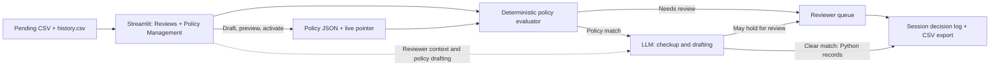
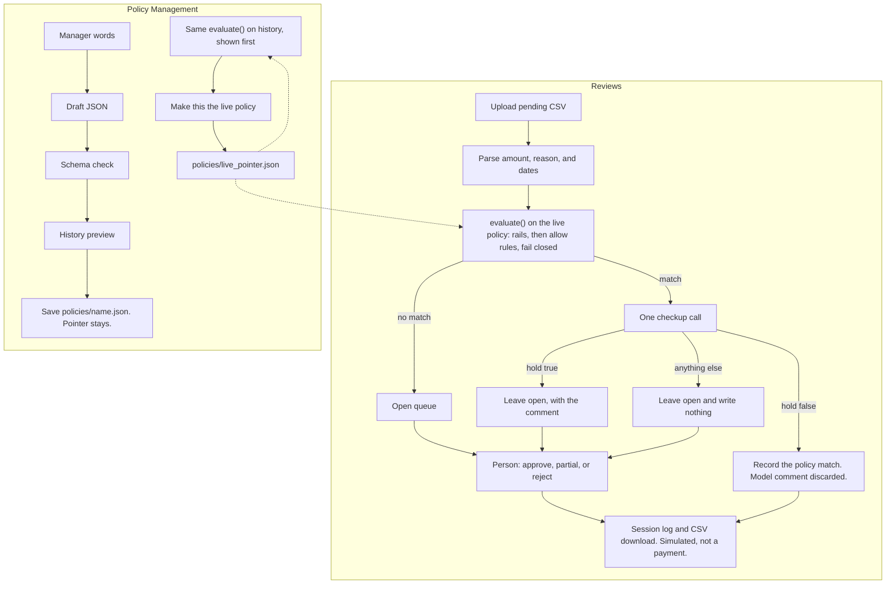

# Refund system

A local Streamlit app that auto-handles refund rows the live policy already matches, and leaves the rest for a person.

## Demo and write-up

- [Screen recording of the demo](https://drive.google.com/file/d/1wUZLuc0g5NVZ4_FXkRlzNu9zEMpSAmNH/view?usp=sharing)
- [Write-up (slides)](https://docs.google.com/presentation/d/16R5Mh4plqwG-gdEcKx40-x3m83gMouaK/edit?usp=sharing&ouid=116218804212255147197&rtpof=true&sd=true)

## Run

I recommend Python 3.13.

From the repository root. Replace `your-key` with the provider key.

Paste this once in PowerShell. It creates `.venv` when that interpreter is missing, installs `requirements.txt`, sets the key, runs the tests, then starts the app. Streamlit starts only if the install and the tests succeed. Open **Reviews** and click **Use pending.csv**, or upload `data/raw/pending.csv` or another CSV with the same columns.

```powershell
if (-not (Test-Path .\.venv\Scripts\python.exe)) { python -m venv .venv }
.\.venv\Scripts\python.exe -m pip install -r requirements.txt
if ($LASTEXITCODE -eq 0) {
  $env:LLM_PROVIDER="openai"
  $env:OPENAI_API_KEY="your-key"
  $env:LLM_MODEL="gpt-4o-mini"
  .\.venv\Scripts\python.exe -m unittest discover -s tests
}
if ($LASTEXITCODE -eq 0) { .\.venv\Scripts\python.exe -m streamlit run app/main.py }
```

After that install, start the app on its own:

```powershell
.\.venv\Scripts\python.exe -m streamlit run app/main.py
```

Run the tests on their own:

```powershell
.\.venv\Scripts\python.exe -m unittest discover -s tests
```

Open **Reviews**. Click **Use pending.csv** or upload a pending CSV, then click Review.
Open **Policy Management** for the manager path: draft a policy, evaluate it based on history, then make a policy live.

On macOS or Linux, from the repository root:

```bash
test -x .venv/bin/python || python3 -m venv .venv
.venv/bin/python -m pip install -r requirements.txt && LLM_PROVIDER=openai OPENAI_API_KEY=your-key LLM_MODEL=gpt-4o-mini .venv/bin/python -m unittest discover -s tests && .venv/bin/python -m streamlit run app/main.py
```

## API key

The model is used for the review checkup and the policy chat. Review and the policy chat stay off until **Apply API key** succeeds for the current provider, model, and key. The Policy Picker still previews history and can switch the live file with no key.

Set the provider, that provider's key, and an optional model on the same command that starts Streamlit. Those process variables win over a repository-root `.env`, because `.env` is loaded with `override=False`.

PowerShell:

```powershell
$env:LLM_PROVIDER="openai"; $env:OPENAI_API_KEY="your-key"; $env:LLM_MODEL="gpt-4o-mini"; .\.venv\Scripts\python.exe -m streamlit run app/main.py
```

Command Prompt:

```bat
set LLM_PROVIDER=openai&& set OPENAI_API_KEY=your-key&& set LLM_MODEL=gpt-4o-mini&& .\.venv\Scripts\python.exe -m streamlit run app/main.py
```

bash:

```bash
LLM_PROVIDER=openai OPENAI_API_KEY=your-key LLM_MODEL=gpt-4o-mini .venv/bin/python -m streamlit run app/main.py
```

In PowerShell and Command Prompt, those assignments stay in that terminal window after Streamlit exits. The bash prefix applies only to that process.

A repository-root `.env` (not committed) works if you leave the sidebar blank:

| `LLM_PROVIDER` | Key variable | Default model |
|---|---|---|
| `openai` (default) | `OPENAI_API_KEY` | `gpt-4o-mini` |
| `anthropic` | `ANTHROPIC_API_KEY` | `claude-haiku-4-5` |
| `gemini` | `GOOGLE_API_KEY` | `gemini-2.5-flash` |

`LLM_MODEL` overrides the default only for the provider named by `LLM_PROVIDER`. A value typed in the sidebar replaces the matching environment value for that session. It is not written to `.env` and not printed. Click **Apply API key**. Changing the provider, model, or key requires Apply again.

## Architecture

Streamlit provides Reviews and Policy Management, with a sidebar for the model provider and key.

Reviews accepts the sample `data/raw/pending.csv` or another uploaded CSV. `data/raw/history.csv` supplies manager-preview data and reviewer context.

`policies/` holds policy JSON files; `policies/live_pointer.json` identifies the live policy. The deterministic evaluator applies it. Managers can draft and preview a policy before explicitly making it live.

The LLM can draft reviewer context and policy JSON, or flag a policy match for human review; it cannot approve requests or activate policy. Decisions are simulated and kept in the Streamlit session.



All decisions are simulated, not payments.

## Workflow



Unknown, malformed, duplicate, and non-finite inputs are never auto-approved. Invalid rows are reported, eligible rows remain for review, and already-logged requests are not decided again.

## AI coding tools

I used a system of agents in Cursor. They wrote code, reviewed it, wrote tests, analyzed the data, and suggested business decisions. One thing they produced, and that I changed, was the auto-approve path. Their version approved a request as soon as a function matched the live policy. I kept the deterministic policy evaluation and added a separate LLM checkup that can hold an existing match for review. A clear checkup does not itself approve anything: Python records the simulated auto-decision only after its checks succeed. The model cannot create a policy match, approve another request, or make a policy live.