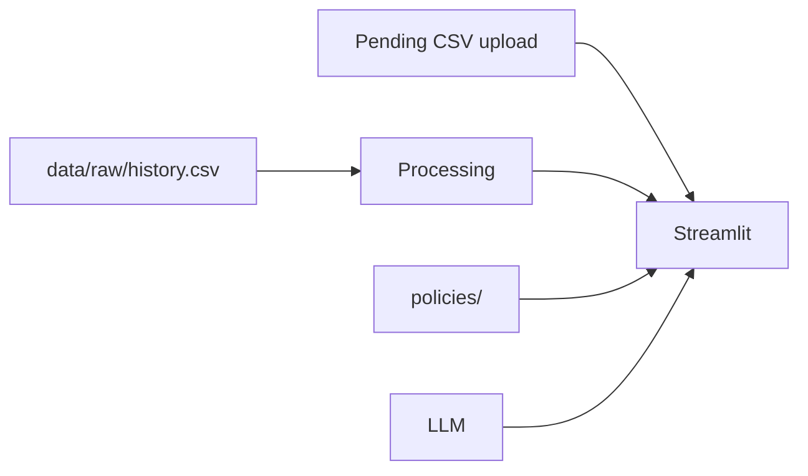
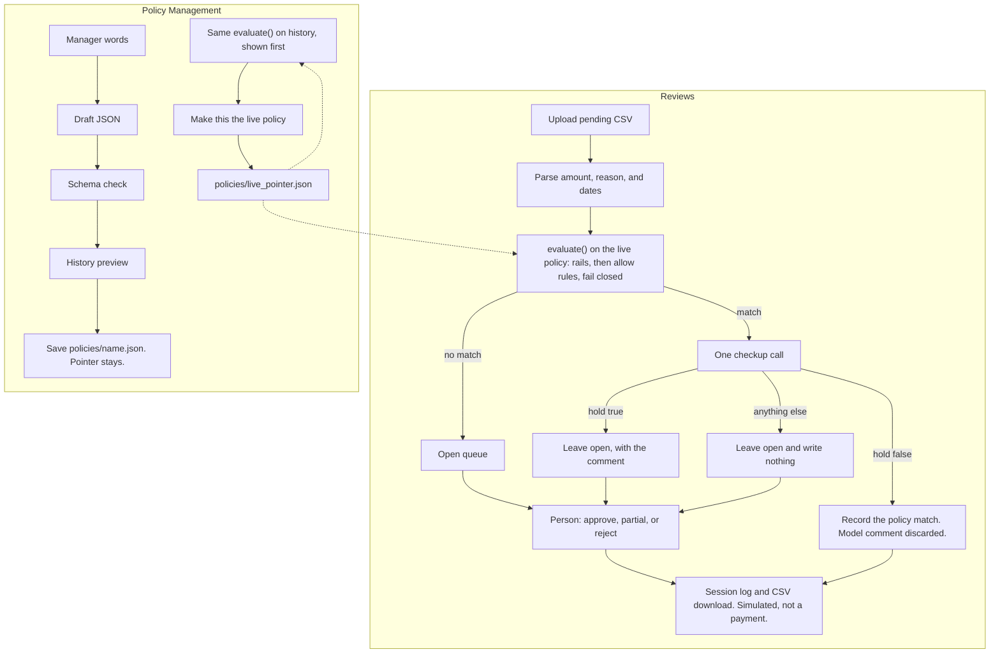

# Refund system

A local Streamlit app that auto-handles refund rows the live policy already matches, and leaves the rest for a person.

## Run

From the repository root. Replace `your-key` with the provider key.

Paste this once in PowerShell. It creates `.venv` when that interpreter is missing, installs `requirements.txt`, sets the key, runs the tests, then starts the app. Streamlit starts only if the install and the tests succeed. Open **Reviews** and upload `data/raw/pending.csv`, or another CSV with the same columns.

```powershell
if (-not (Test-Path .\.venv\Scripts\python.exe)) { python -m venv .venv }
.\.venv\Scripts\python.exe -m pip install -r requirements.txt
if ($LASTEXITCODE -eq 0) {
  $env:LLM_PROVIDER="openai"
  $env:OPENAI_API_KEY="your-key"
  $env:LLM_MODEL="gpt-4o-mini"
  .\.venv\Scripts\python.exe -m unittest discover -s tests
}
if ($LASTEXITCODE -eq 0) { .\.venv\Scripts\python.exe -m streamlit run app/main.py }
```

After that install, start the app on its own:

```powershell
.\.venv\Scripts\python.exe -m streamlit run app/main.py
```

Run the tests on their own:

```powershell
.\.venv\Scripts\python.exe -m unittest discover -s tests
```

Open **Reviews**. Upload pending.csv, and click Review.
Open **Policy Management** for the manager path: draft a policy, evaluate it based on history, then make a policy live.

On macOS or Linux, from the repository root:

```bash
test -x .venv/bin/python || python3 -m venv .venv
.venv/bin/python -m pip install -r requirements.txt && LLM_PROVIDER=openai OPENAI_API_KEY=your-key LLM_MODEL=gpt-4o-mini .venv/bin/python -m unittest discover -s tests && .venv/bin/python -m streamlit run app/main.py
```

## API key

The model is used for the review checkup and the policy chat. Review and the policy chat stay off until **Apply API key** succeeds for the current provider, model, and key. The Policy Picker still previews history and can switch the live file with no key.

Set the provider, that provider's key, and an optional model on the same command that starts Streamlit. Those process variables win over a repository-root `.env`, because `.env` is loaded with `override=False`.

PowerShell:

```powershell
$env:LLM_PROVIDER="openai"; $env:OPENAI_API_KEY="your-key"; $env:LLM_MODEL="gpt-4o-mini"; .\.venv\Scripts\python.exe -m streamlit run app/main.py
```

Command Prompt:

```bat
set LLM_PROVIDER=openai&& set OPENAI_API_KEY=your-key&& set LLM_MODEL=gpt-4o-mini&& .\.venv\Scripts\python.exe -m streamlit run app/main.py
```

bash:

```bash
LLM_PROVIDER=openai OPENAI_API_KEY=your-key LLM_MODEL=gpt-4o-mini .venv/bin/python -m streamlit run app/main.py
```

In PowerShell and Command Prompt, those assignments stay in that terminal window after Streamlit exits. The bash prefix applies only to that process.

A repository-root `.env` (not committed) works if you leave the sidebar blank:

| `LLM_PROVIDER` | Key variable | Default model |
|---|---|---|
| `openai` (default) | `OPENAI_API_KEY` | `gpt-4o-mini` |
| `anthropic` | `ANTHROPIC_API_KEY` | `claude-haiku-4-5` |
| `gemini` | `GOOGLE_API_KEY` | `gemini-2.5-flash` |

`LLM_MODEL` overrides the default only for the provider named by `LLM_PROVIDER`. A value typed in the sidebar replaces the matching environment value for that session. It is not written to `.env` and not printed. Click **Apply API key**. Changing the provider, model, or key requires Apply again.

## Architecture

Streamlit is the app. It has two pages, Reviews and Policy Management, and a sidebar for the provider, key, and model.

The reviewer uploads a pending CSV on Reviews. `data/raw/pending.csv` is the sample file for that upload. `data/raw/history.csv` is read from disk. It is the past sample for the manager preview and for similar rows on a review.

`policies/` holds one JSON file per policy. `policies/live_pointer.json` names the live file. The evaluator reads that file and does not call the model. Policy Management can save a new file without moving the pointer. The picker writes the pointer after the history preview.

The LLM is a separate component: OpenAI, Claude, or Gemini, chosen in the sidebar. Reviews call it for the checkup and for a comment on an open row. Policy Builder calls it to turn a manager's words into draft JSON. It does not approve a refund or make a policy live.

The decision log stays in the Streamlit session. The CSV download is the copy you can keep.



## Workflow



Unknown, malformed, duplicate, already-logged, and non-finite inputs go to a person.

## AI coding tools

I used a system of agents in Cursor. They wrote code, reviewed it, wrote tests, analyzed the data, and suggested business decisions. One thing they produced, and that I changed, was the auto-approve path. Their version approved a request as soon as a function matched the live policy. I still use that function for the policy decision, then give its result to the agent. It looks for anything else that makes the match unsafe, such as a contradiction in the notes or a duplicate request. The agent can approve that auto-approve, or refuse it and send the row to review. It cannot approve anything else.